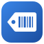
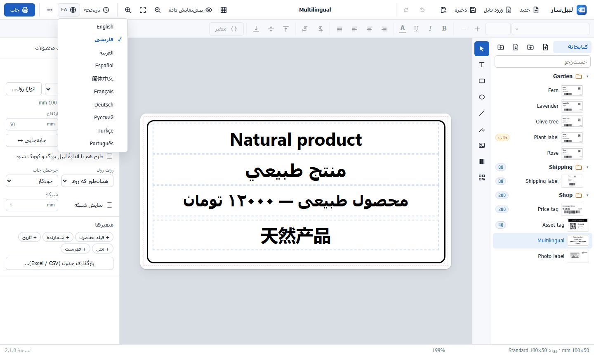

<p align="center">
  
</p>

<h1 align="center">LabelPrint Studio</h1>

<p align="center">
  <b>Free label design and printing software for thermal label printers on Windows.</b><br>
  Make barcode labels, QR code labels, price tags, shipping labels and product labels, and print them on TSC / TSPL printers or any Windows printer.
</p>

<p align="center">
  <a href="https://github.com/a-Arani/labelprint-studio/releases/latest"><b>⬇ Download for Windows</b></a> ·
  <a href="#how-to-install">How to install</a> ·
  <a href="#print-your-first-label">Print your first label</a> ·
  <a href="#faq">FAQ</a>
</p>

<p align="center">
  <a href="https://github.com/a-Arani/labelprint-studio/releases/latest"></a>
  <a href="https://github.com/a-Arani/labelprint-studio/actions/workflows/ci.yml"></a>
  <a href="LICENSE"></a>
  
</p>


LabelPrint Studio is a free, open-source **label maker for Windows**. Design labels like in Word or Paint, add **barcodes, QR codes and serial numbers**, and print straight to a **thermal label printer** such as the TSC TE200, or to any printer installed in Windows. It is a free alternative to commercial label software such as BarTender, NiceLabel or ZebraDesigner, with no account, no subscription and no internet connection needed.

## Contents

- [Features](#features)
- [Supported label printers](#supported-label-printers)
- [How to install](#how-to-install)
- [Print your first label](#print-your-first-label)
- [Screenshots](#screenshots)
- [FAQ](#faq)
- [Where your labels are stored](#where-your-labels-are-stored)
- [Run from source](#run-from-source)
- [Contributing](#contributing)
- [License](#license)

## Features

**Label designer**
- Text in any font installed on your computer, with bold, italic, colours and alignment, even for part of a line.
- Barcodes: Code 128, EAN-13, EAN-8, UPC-A, Code 39, ITF, ITF-14 and Codabar.
- QR codes with text, links or variables.
- Shapes, lines, images, logos and freehand drawing; undo/redo, alignment, layers, copy and paste.

**Serial numbers and variables**
- Counters with prefix, suffix and leading zeros: print labels *1001 to 1500* and each one gets its own number.
- Dates (Gregorian, Persian/Jalali or Hijri calendar), text asked at print time, lists, and data from **Excel or CSV** files.

**Templates for many products**
- Design one master label, then create a label for each product by filling in its name, size, price and other fields, one at a time or in bulk from Excel.

**Rolls with one or more labels per row**
- Set the roll width, labels across, label size, gaps and margins, and see them in a diagram.
- Portrait or landscape designs are rotated automatically to fit the roll.

**Import from Word and PowerPoint**
- Open `.docx` and `.pptx` label files as editable labels: one file, many files or a whole folder.

**Print history and safety**
- Every print job is recorded: how many labels, which numbers, on which printer. The next print continues after the last number.
- Automatic saving, previous versions of each label, a recycle bin and daily backups.

**10 interface languages**
- English, Persian, Arabic, Spanish, Chinese (Simplified), French, German, Russian, Turkish and Portuguese, with a full right-to-left interface for Persian and Arabic.

## Supported label printers

| Printer | Print method in the app |
| --- | --- |
| **TSC** label printers (tested on the TE200; TE210, TE300, TTP-244 Pro, DA200 and others use the same TSPL language) | **Direct (TSPL)**: fast and pixel-exact, with gap / black-mark sensing, darkness and speed settings |
| Other **TSPL / TSPL2** thermal printers, also **over the network** | **Direct (TSPL)** for USB, or **Network (IP)** on port 9100 |
| **Any printer installed in Windows**: Zebra, Godex, Xprinter, Brother, office and PDF printers | **Windows driver**: prints through the printer's own driver |

Labels are rendered at the printer's resolution (203, 300 or 600 dpi) in sharp black and white, so small text and barcodes scan reliably.

## How to install

### Requirements

- Windows 10 or Windows 11 (64-bit).
- Microsoft Edge (built into Windows) or Google Chrome.
- For a USB printer: the printer installed in Windows with its driver (for TSC printers, the driver from the TSC website). A network printer only needs its IP address.

### Install the Windows version (recommended)

You do **not** need to install Python or anything else; everything is included.

1. Open the **[latest release](https://github.com/a-Arani/labelprint-studio/releases/latest)** and download **`LabelPrintStudio-v2.0.0-win64.zip`** (under *Assets*).
2. Right-click the downloaded file → **Extract All…** and extract it to a permanent folder, for example `C:\LabelPrintStudio`.
3. Open the extracted folder and double-click **`Create Desktop Shortcut.bat`** (only once).
4. Start **LabelPrint Studio** from the new desktop shortcut.

If Windows shows *"Windows protected your PC"*, click **More info → Run anyway**. This appears for downloaded programs that are not code-signed.

### Update to a new version

1. Close LabelPrint Studio.
2. Download and extract the new zip.
3. Copy the folders `app`, `web`, `python` and the file `run.py` from the new version over your installation folder.

Your `data` folder (labels, settings, print history) is not touched.

### Uninstall

Delete the installation folder and the desktop shortcut. Copy the `data` folder somewhere first if you want to keep your labels.

## Print your first label

1. Click **New** and enter the label size in millimetres (for example 100 × 50), or pick a common size.
2. Add text, a barcode or a QR code from the toolbar on the left.
3. For numbered labels, click **+ Counter** in the right panel and insert it into a text or barcode.
4. In the right panel, choose your **roll**, or click **Rolls…** to describe it (labels per row, label size, gaps).
5. Click **Print**, select your printer, choose **Direct (TSPL)** for a TSC printer, set the number range and press **Print**.

**Tip:** after loading a new roll into a TSC printer, use **Rolls… → Printer tools → Calibrate sensor**, then **Print layout test** to check the position before printing a large batch.

## Screenshots

<table>
  <tr>
    <td></td>
    <td></td>
  </tr>
  <tr>
    <td align="center">Printing price tags on a two-across roll</td>
    <td align="center">Roll setup: labels per row, sizes and gaps</td>
  </tr>
  <tr>
    <td></td>
    <td></td>
  </tr>
  <tr>
    <td align="center">Product labels from one template</td>
    <td align="center">Print history and totals</td>
  </tr>
  <tr>
    <td></td>
    <td></td>
  </tr>
  <tr>
    <td align="center">Right-to-left interface</td>
    <td align="center">10 interface languages</td>
  </tr>
</table>

## FAQ

### Is LabelPrint Studio free?
Yes. It is free and open source under the MIT License, for personal and commercial use.

### Which label printers does it work with?
TSC and other TSPL/TSPL2 thermal label printers (USB or network) are supported directly. Any other printer installed in Windows, including Zebra, Godex, Xprinter and Brother, works through the **Windows driver** method.

### How do I print barcode labels with serial numbers?
Add a **Counter** variable, insert it into a barcode (or text), and enter the range in the print dialog, for example *from 1 to 500*. The print history remembers where you stopped.

### Can I print two or more labels per row?
Yes. Describe your roll under **Rolls…** (labels per row, label width, gaps). The app fills each row in sequence, or prints the same label across the row.

### Can I open my existing labels from Word or PowerPoint?
Yes. Use **Import** to open `.docx` and `.pptx` files, or a whole folder of them, as editable labels.

### Does it need internet or an account?
No. LabelPrint Studio runs entirely on your computer and works offline.

### Does it support Arabic, Persian and other right-to-left text?
Yes, both on labels and in the interface, with correct number order and Persian and Arabic digits.

### Nothing prints. What should I check?
Make sure the printer is installed in Windows and selected in the print dialog. If **Direct (TSPL)** does not work for your printer, choose **Windows driver**. For help, open **⋯ → App logs → Create diagnostics file** and attach the file to a [new issue](https://github.com/a-Arani/labelprint-studio/issues).

## Where your labels are stored

Everything is stored in the `data` folder inside the installation folder (or in `%LOCALAPPDATA%\LabelPrintStudio` if that folder is read-only):

| Folder | Contents |
| --- | --- |
| `data\library` | Your labels and folders |
| `data\versions` | Previous versions of each label |
| `data\trash` | Deleted labels |
| `data\backups` | Daily backups (last 14 days) |
| `data\logs` | Logs for troubleshooting |
| `data\history.db` | Print history |

## Run from source

For developers. Requires Windows 10/11 and [Python](https://www.python.org/downloads/) 3.10 or newer. No other packages are needed.

```bash
git clone https://github.com/a-Arani/labelprint-studio.git
cd labelprint-studio
python run.py
```

Or click the green **Code → Download ZIP** button on this page, extract it and run `python run.py` in that folder.

Run the tests with `pip install -r requirements-dev.txt` and `python -m pytest -q`. Build the Windows package with `./build_package.ps1`. The project layout and translation guide are in [CONTRIBUTING.md](CONTRIBUTING.md).

## Contributing

Bug reports, translations and pull requests are welcome. Please read [CONTRIBUTING.md](CONTRIBUTING.md) first.

## License

LabelPrint Studio is released under the [MIT License](LICENSE).

Designed and developed by **Amirhossein Arani** ([@a-Arani](https://github.com/a-Arani)).

Third-party components: [JsBarcode](https://github.com/lindell/JsBarcode) and [QR Code Generator](https://github.com/kazuhikoarase/qrcode-generator) (MIT); the Windows package includes [Python](https://www.python.org/) (PSF License). See [THIRD_PARTY_NOTICES.md](THIRD_PARTY_NOTICES.md).

TSC, BarTender, NiceLabel, ZebraDesigner, Zebra, Godex, Xprinter and Brother are trademarks of their respective owners. This project is not affiliated with or endorsed by them.
