<a href="https://github.com/a-Arani/labelprint-studio/releases/latest">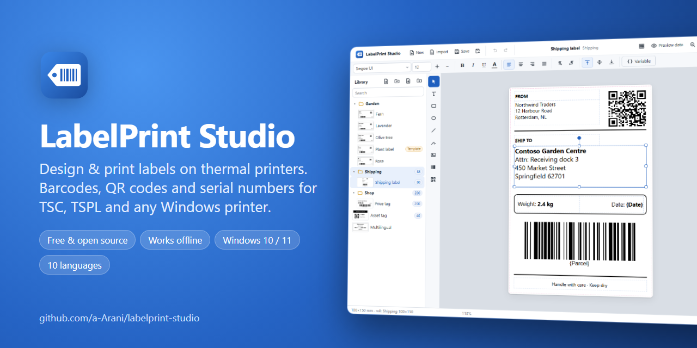</a>

<p align="center">
  <a href="https://github.com/a-Arani/labelprint-studio/releases/latest"></a>
</p>

<p align="center">
  <a href="#-how-to-install"><b>How to install</b></a> ·
  <a href="#-features">Features</a> ·
  <a href="#-supported-label-printers">Printers</a> ·
  <a href="#-faq">FAQ</a> ·
  <a href="#-source-code">Source code</a>
</p>

<p align="center">
  <a href="https://github.com/a-Arani/labelprint-studio/releases/latest"></a>
  <a href="https://github.com/a-Arani/labelprint-studio/releases"></a>
  <a href="https://github.com/a-Arani/labelprint-studio/actions/workflows/ci.yml"></a>
  <a href="LICENSE"></a>
  
</p>

**LabelPrint Studio** is free label design and printing software for Windows. Make **barcode labels, QR code labels, price tags, shipping labels and product labels**, number them automatically, and print them on **TSC and other thermal label printers** or on any printer installed in Windows.

No account, no subscription, no internet connection: download, unzip and start printing. A free, open-source alternative to commercial label software such as BarTender, NiceLabel or ZebraDesigner.

## 🎬 See it in action

<p align="center">
  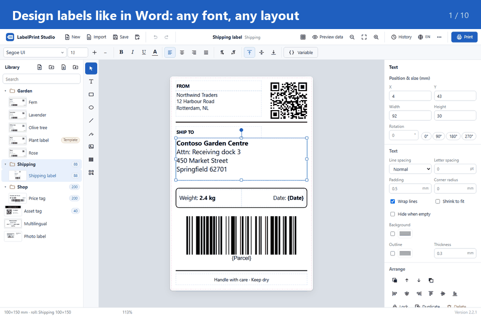
</p>

## 💡 Why LabelPrint Studio?

| | |
| --- | --- |
| 🆓 **Free forever** | Open source under the MIT license, for home and business use. No trial, no watermark. |
| 🖨️ **Made for thermal printers** | Prints directly in the TSC/TSPL printer language, pixel-exact at 203 or 300 dpi. |
| 🔢 **Serial numbers in one click** | Print labels *1001 to 5000*; every label gets its own number and barcode. |
| 📦 **One template, every product** | Design once, then fill in name, size and price for each product, or import them all from Excel. |
| 🖼️ **A photo editor built in** | Crop, rotate, adjust and remove backgrounds, with black-and-white modes made for thermal printers. |
| 🎯 **Perfect position** | Print one test label, nudge the print a fraction of a millimetre, then print the batch. |
| 🎛️ **Full printer control** | Feed, reverse feed, calibrate, self-test and cutter/peel modes without touching the printer. |
| 🧾 **Never print a number twice** | The print history remembers where you stopped and warns before reprinting. |
| 🌍 **Speaks your language** | 10 interface languages, with full right-to-left support for Arabic and Persian. |

## ✨ Features

<table>
<tr>
<td width="44%">

### Design labels like in Word

Text in any font installed on your PC, with bold, italic, colours and alignment, even for part of a line. Add shapes, lines, logos, images and freehand drawings. Undo, align, layer, copy and paste just as you expect.

Open existing **Word (.docx)** and **PowerPoint (.pptx)** labels as editable designs: one file or a whole folder at once.

</td>
<td>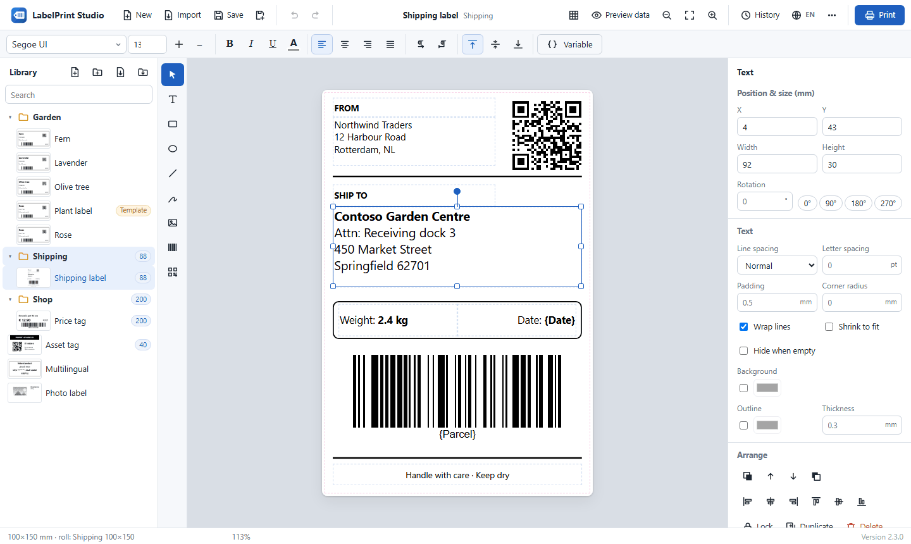</td>
</tr>
<tr>
<td>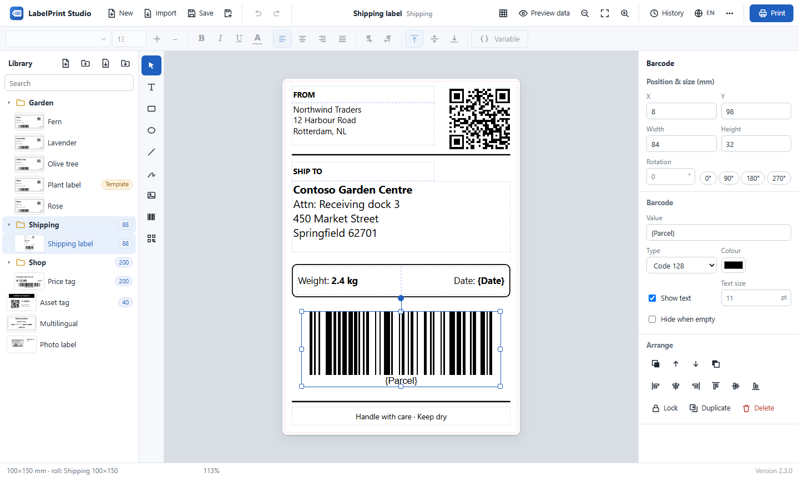</td>
<td>

### Barcodes, QR codes and serial numbers

**Code 128, EAN-13, EAN-8, UPC-A, Code 39, ITF, ITF-14, Codabar** and **QR codes**.

Insert variables anywhere: counters with prefix and leading zeros (`PKG-001001`), today's date in Gregorian, Persian or Hijri calendar, text asked at print time, or columns from an **Excel / CSV** file.

</td>
</tr>
<tr>
<td>

### A photo editor built in

Double-click any picture to **crop** it (free or 1:1, 4:3, 16:9…), **trim** empty borders, **rotate**, **mirror**, and fine-tune **brightness, contrast, midtones, sharpness** and **opacity**. Give it **rounded corners** or a **circle** shape, or **remove the background** with one click or an eyedropper.

Thermal printers print only black dots, so every picture has its own **black-and-white mode**: a clean threshold for logos and text, or **dithering** that keeps photos looking like photos. *Show as printed* previews it at the printer's real dots. Nothing is ever lost: edits can be changed or reset at any time.

</td>
<td>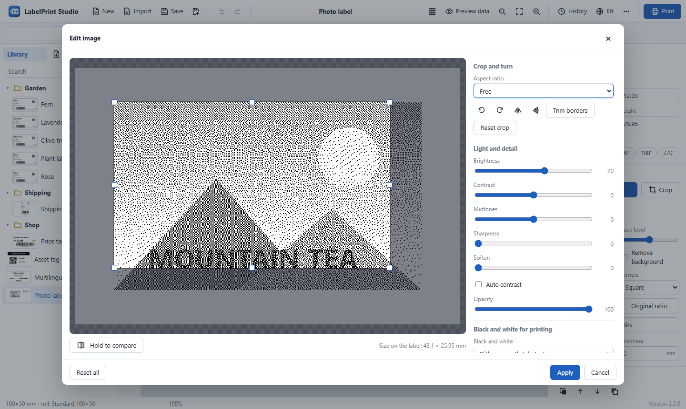</td>
</tr>
<tr>
<td>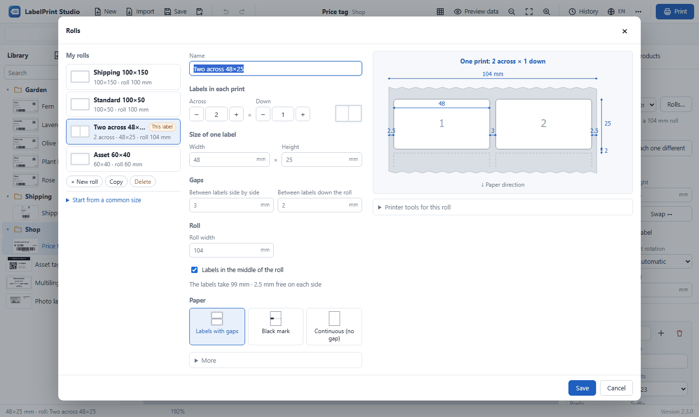</td>
<td>

### Any label roll, several labels across

Describe your roll the way you see it: **how many labels in each print** (across, and down if ever needed), **the size of one label**, the gaps and the roll width. A large picture shows the roll with the labels numbered in print order and highlights each size as you type it. If the numbers do not add up, one click fixes them. Start from a common size, or from your own rolls.

On the canvas you see **the whole width of the roll**. With **All the same**, you design one label and the others show it as copies. With **Each one different**, all the labels of a print are designed together, side by side, and cut apart for printing.

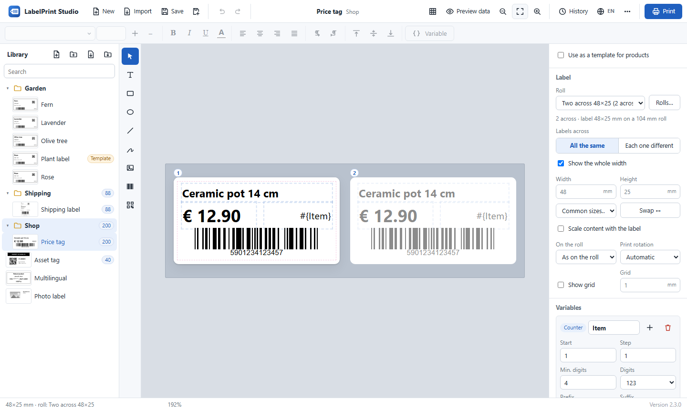

Designed in portrait but the roll is landscape? LabelPrint Studio **rotates the design automatically** to fit.

</td>
</tr>
<tr>
<td>

### Print straight to the printer

See exactly what will be printed, choose the number range and copies, and print. Darkness, speed and the printer's resolution are all in the print window.

Works with **TSC / TSPL** printers over USB or the network, and with **any Windows printer** through its driver.

</td>
<td>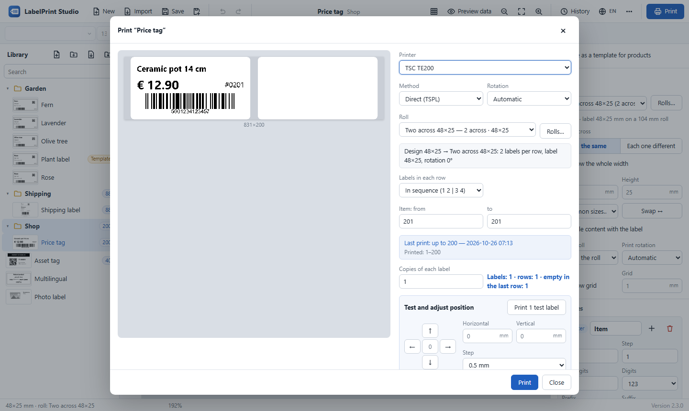</td>
</tr>
<tr>
<td>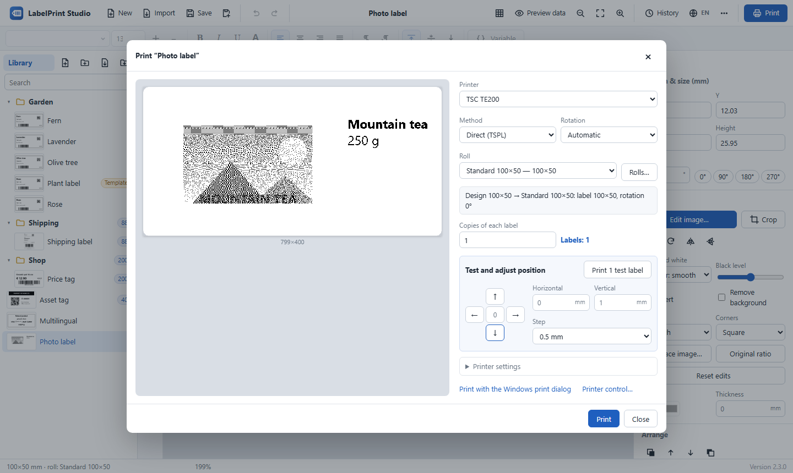</td>
<td>

### Test first, then print them all

Every printer and every roll is a little different. Print **one test label** (it is not counted in the history and uses no numbers), then **nudge the print** up, down, left or right in steps from 0.1 mm, and print the whole batch exactly in place.

The preview shows the shift live and warns you if any part would fall off the label.

</td>
</tr>
<tr>
<td>

### Full printer control

Everything you would do on the printer itself, from your desk: **feed** one label or any distance, **reverse feed** one label or any distance (optionally a little further, then forward until the sensor finds the gap, so the paper stops exactly at a label), go to the start of the label, **calibrate** the gap or black-mark sensor, print the **self-test page** or an **alignment test with millimetre rulers**, **beep** to find the printer, and switch between **tear-off, peel-off and cutter** modes. Power users can send any **TSPL command**.

</td>
<td>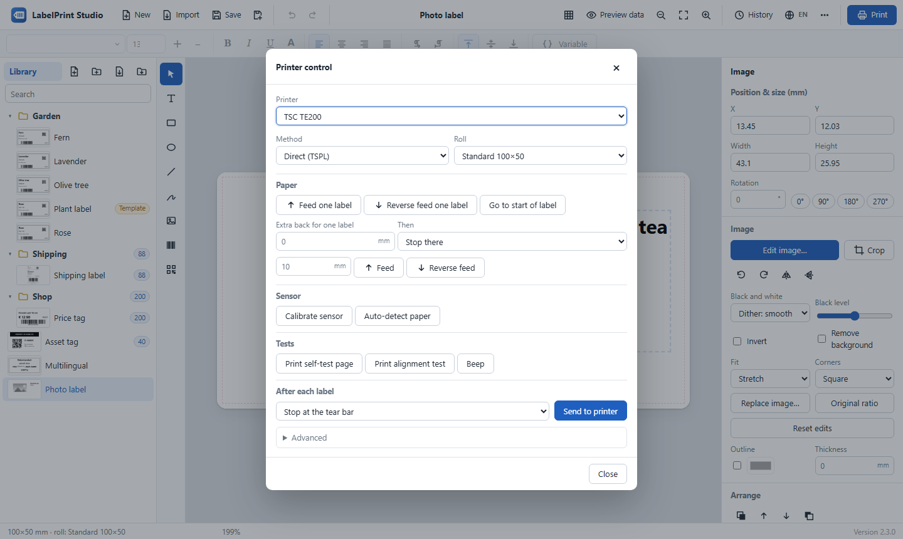</td>
</tr>
<tr>
<td>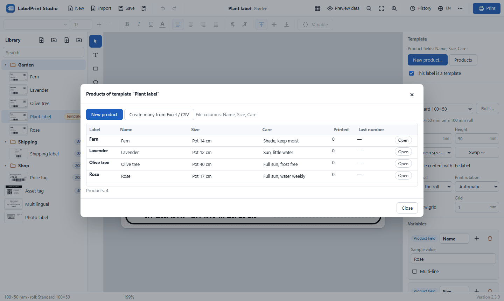</td>
<td>

### One template, a label for every product

Make a master label with fields such as *Name*, *Size* and *Price*. Create a product label by filling in the fields, or create hundreds at once from an Excel sheet. Edit everything in a spreadsheet-like table.

</td>
</tr>
<tr>
<td>

### Know what was printed

Every print job is recorded: which label, how many, which numbers and on which printer. The next print continues from the last number, and a jammed printer can be corrected by hand. Export to Excel.

Your work is safe: automatic saving, previous versions of each label, a recycle bin and daily backups.

</td>
<td>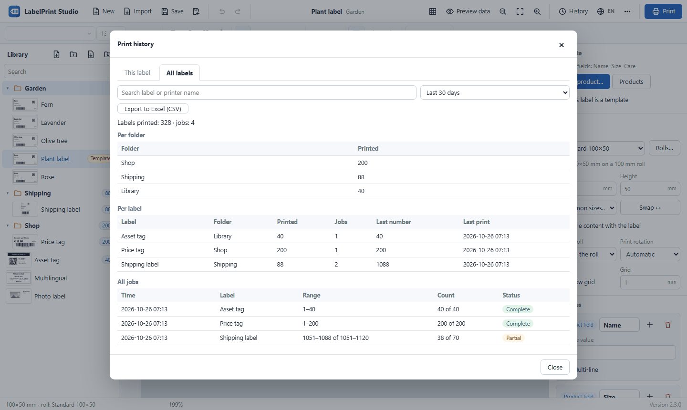</td>
</tr>
<tr>
<td>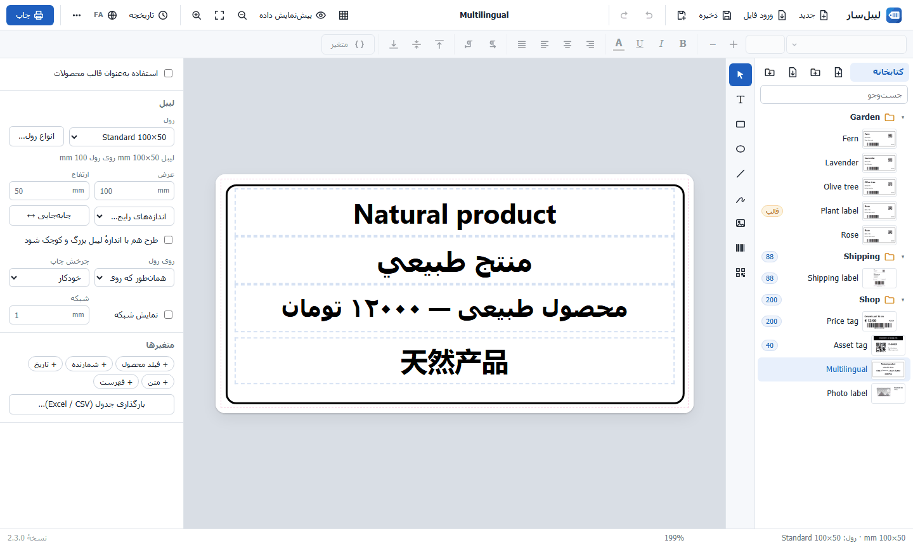</td>
<td>

### 10 languages, right-to-left ready

English, Arabic, Persian, Spanish, Chinese (Simplified), French, German, Russian, Turkish and Portuguese. Arabic and Persian get a full right-to-left interface, and labels can mix any scripts.

</td>
</tr>
</table>

## 🖨️ Supported label printers

| Printer | Print method in the app |
| --- | --- |
| **TSC** thermal label printers: tested on the **TE200**; TE210, TE300, TTP-244 Pro, TTP-247, DA200 and other models use the same TSPL language | **Direct (TSPL)**: fast and pixel-exact, with gap / black-mark sensing, darkness and speed |
| Other **TSPL / TSPL2** thermal printers, including **network** printers | **Direct (TSPL)** over USB, or **Network (IP)** on port 9100 |
| **Any printer installed in Windows**: Zebra, Godex, Xprinter, Brother, office and PDF printers | **Windows driver**: prints through the printer's own driver |

Labels are rendered at the printer's resolution (203, 300 or 600 dpi) in sharp black and white, so small text and barcodes scan reliably.

## 📥 How to install

### Requirements

- Windows 10 or Windows 11 (64-bit)
- Microsoft Edge (built into Windows) or Google Chrome
- For a USB printer: the printer installed in Windows with its driver (for TSC printers, the driver from the TSC website). A network printer only needs its IP address.

### Install in 4 steps

You do **not** need to install Python or anything else; everything is included.

1. Open the **[latest release](https://github.com/a-Arani/labelprint-studio/releases/latest)** and download **`LabelPrintStudio-v2.3.0-win64.zip`** under *Assets*.
2. Right-click the downloaded file → **Extract All…** and extract it to a permanent folder, for example `C:\LabelPrintStudio`.
3. Open the extracted folder and double-click **`Create Desktop Shortcut.bat`** (only once).
4. Start **LabelPrint Studio** from the new desktop shortcut.

> If Windows shows *"Windows protected your PC"*, click **More info → Run anyway**. This appears for downloaded programs that are not code-signed.

### Update to a new version

Close the app, download and extract the new zip, then copy the folders `app`, `web`, `python`, the file `run.py` and the `.bat` files over your installation folder. Your `data` folder (labels, settings, print history) stays untouched.

### Uninstall

Run **`Stop LabelPrint Studio.bat`** in the installation folder (it ends every running part of the app, also of older versions or other copies), then delete the folder and the desktop shortcut. Copy the `data` folder somewhere first if you want to keep your labels. The app window's own browser profile is in `%LOCALAPPDATA%\LabelPrintStudio\browser`; you can delete it too.

## 🚀 Print your first label

1. Click **New** and enter the label size in millimetres (for example 100 × 50), or pick a common size.
2. Add text, a barcode or a QR code from the toolbar on the left.
3. For numbered labels, click **+ Counter** in the right panel and insert it into a text or barcode.
4. Choose your **roll** when you create the label (or later in the right panel), or click **Rolls…** to describe it (labels in each print, the size of one label, gaps); the label takes the size of one of its labels.
5. Click **Print**, select your printer, choose **Direct (TSPL)** for a TSC printer, set the number range and press **Print**.

> **Tip:** after loading a new roll into a TSC printer, open **Rolls… → Printer tools → Calibrate sensor**, then **Print layout test** to check the position before printing a large batch.

## ❓ FAQ

<details>
<summary><b>Is LabelPrint Studio really free?</b></summary>

Yes. It is free and open source under the MIT License, for personal and commercial use, with no limits or watermarks.
</details>

<details>
<summary><b>Which label printers does it work with?</b></summary>

TSC and other TSPL/TSPL2 thermal label printers (USB or network) are supported directly. Any other printer installed in Windows, including Zebra, Godex, Xprinter and Brother, works through the **Windows driver** method.
</details>

<details>
<summary><b>How do I print barcode labels with serial numbers?</b></summary>

Add a **Counter** variable, insert it into a barcode (or text), and enter the range in the print dialog, for example *from 1 to 500*. The print history remembers where you stopped.
</details>

<details>
<summary><b>Can I print two or more labels across the roll?</b></summary>

Yes. Under **Rolls…**, set **Labels in each print**, for example *2 across × 1 down*, and the size of **one** label. The app fills each print in sequence (1 2 | 3 4), or prints the same label across it.
</details>

<details>
<summary><b>My print is slightly off the label. How do I fix it?</b></summary>

In the print window, click **Print 1 test label**, look at it, then use the arrow buttons under *Test and adjust position* to move the print (for example 0.5 mm to the right) and print again. When it is right, press **Print** for the whole batch. For a printer that is always off by the same amount, set a fixed offset under *Printer settings*.
</details>

<details>
<summary><b>How do I make photos and logos print well on a thermal printer?</b></summary>

Double-click the picture to open the image editor. For logos and text choose **Black and white → Threshold** and adjust the *Black level*; for photos choose **Dither: smooth**. Turn on *Show as printed* to see the exact dots the printer will make. *Remove background* makes white areas transparent.
</details>

<details>
<summary><b>Can I feed or reverse-feed the paper from the app?</b></summary>

Yes. Open **⋯ → Printer control…** to feed one label or any distance, reverse feed one label or any distance, calibrate the sensor, print the self-test page or an alignment test, and switch tear-off, peel-off or cutter mode. This works with TSC and other TSPL printers (Direct or Network method).
</details>

<details>
<summary><b>Can I open my existing labels from Word or PowerPoint?</b></summary>

Yes. Use **Import** to open `.docx` and `.pptx` files, or a whole folder of them, as editable labels.
</details>

<details>
<summary><b>Does it need internet or an account?</b></summary>

No. LabelPrint Studio runs entirely on your computer and works offline. Your labels never leave your PC.
</details>

<details>
<summary><b>Does it support Arabic, Persian and other right-to-left text?</b></summary>

Yes, both on labels and in the interface, with correct number order and Arabic or Persian digits.
</details>

<details>
<summary><b>Nothing prints. What should I check?</b></summary>

Make sure the printer is installed in Windows and selected in the print dialog. If **Direct (TSPL)** does not work for your printer, choose **Windows driver**. For help, open **⋯ → App logs → Create diagnostics file** and attach the file to a [new issue](https://github.com/a-Arani/labelprint-studio/issues).
</details>

## 💻 Source code

All source code is in this repository. The app is a small local web app: a Python server (standard library only, no dependencies) and a plain JavaScript interface that opens in its own window.

```
labelprint-studio/
├── run.py                  Starts the server and opens the app window
├── app/                    Python server
│   ├── server.py           Local HTTP server and API
│   ├── printing.py         TSPL, Windows driver (GDI), network printing and printer commands
│   ├── office_import.py    Word / PowerPoint import
│   ├── library.py          Labels and folders on disk
│   ├── history.py          Print history (SQLite)
│   ├── backup.py           Versions, daily backups, diagnostics
│   └── meta.py             App name, version and author
├── web/                    User interface (HTML, CSS, JavaScript modules)
│   ├── js/                 Editor, panels, image editor, printing, printer control, rolls, history, ...
│   ├── i18n/               Translations (10 languages)
│   └── vendor/             JsBarcode and QR code generator
├── tests/                  Automated tests (pytest, Playwright)
├── packaging/              Files for the Windows download
└── build_package.ps1       Builds the Windows zip
```

### Run from source

Requires Windows 10/11 and [Python](https://www.python.org/downloads/) 3.10 or newer. No other packages are needed.

```bash
git clone https://github.com/a-Arani/labelprint-studio.git
cd labelprint-studio
python run.py
```

Or click the green **Code → Download ZIP** button on this page, extract it and run `python run.py` in that folder.

Run the tests with `pip install -r requirements-dev.txt` and `python -m pytest -q`, and build the Windows package with `./build_package.ps1`. More in [CONTRIBUTING.md](CONTRIBUTING.md).

### Where your labels are stored

Everything is stored in the `data` folder inside the installation folder (or in `%LOCALAPPDATA%\LabelPrintStudio` if that folder is read-only): labels in `data\library`, previous versions in `data\versions`, deleted labels in `data\trash`, daily backups in `data\backups`, logs in `data\logs` and the print history in `data\history.db`. Closing the app window stops the app completely within a few seconds; nothing keeps running in the background.

## 🤝 Contributing

Bug reports, ideas, translations and pull requests are welcome. Please read [CONTRIBUTING.md](CONTRIBUTING.md) first, or [open an issue](https://github.com/a-Arani/labelprint-studio/issues).

**If LabelPrint Studio saves you time, please give it a ⭐ on GitHub; it helps others find it.**

## 📄 License

LabelPrint Studio is released under the [MIT License](LICENSE).

Designed and developed by **Amirhossein Arani** ([@a-Arani](https://github.com/a-Arani)).

Third-party components: [JsBarcode](https://github.com/lindell/JsBarcode) and [QR Code Generator](https://github.com/kazuhikoarase/qrcode-generator) (MIT); the Windows package includes [Python](https://www.python.org/) (PSF License). See [THIRD_PARTY_NOTICES.md](THIRD_PARTY_NOTICES.md).

<sub>TSC, BarTender, NiceLabel, ZebraDesigner, Zebra, Godex, Xprinter and Brother are trademarks of their respective owners. This project is not affiliated with or endorsed by them.</sub>
